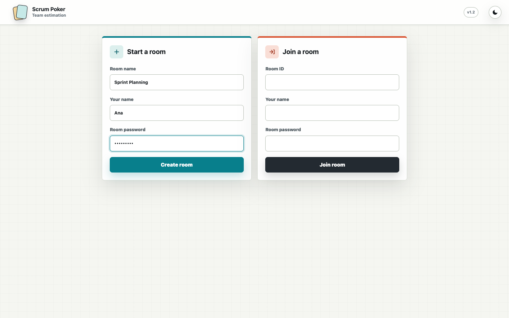
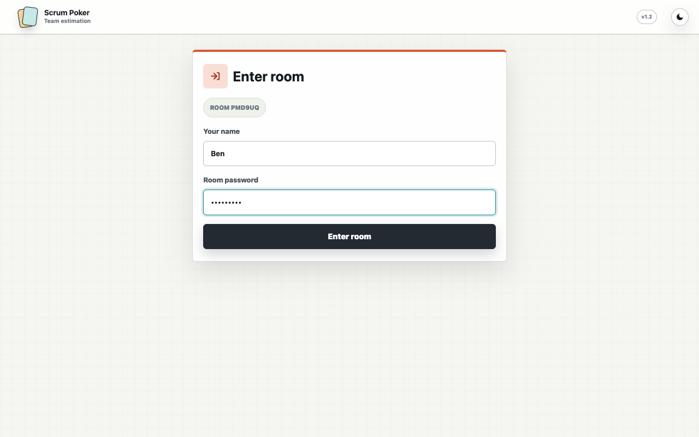
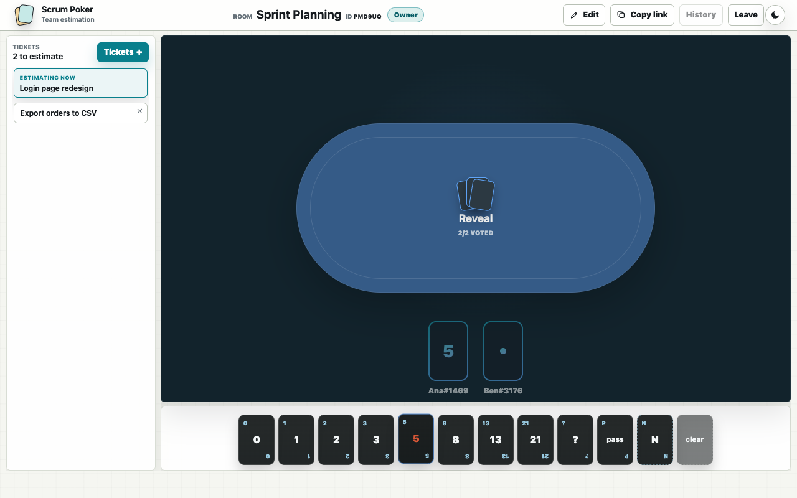
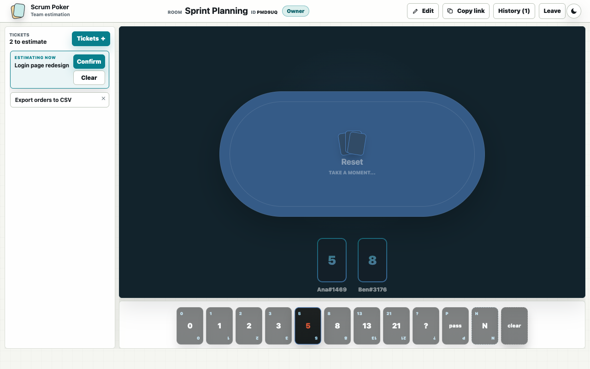
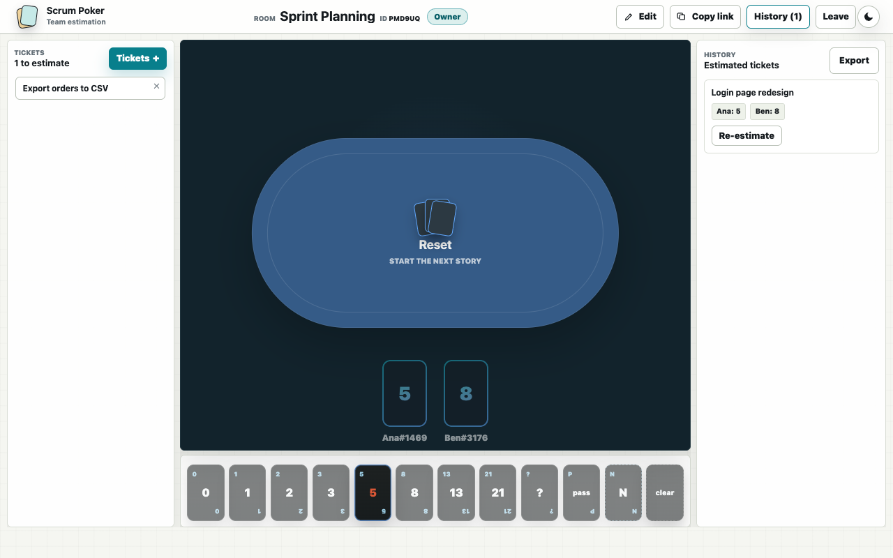

# Scrum Poker

A small Scrum Poker app for remote teams. Password-protected rooms, hidden votes, one Node file and SQLite. No external services.

## How to use

1. **Create a room.** Pick a room name, your name and a password.

   

2. **Invite your team.** Use **Copy link** and send the link. Share the password separately. Teammates open the link, enter a name and the password.

   

3. **Add tickets and vote.** Add the stories with **Tickets +**, click one to estimate it, then everyone picks a card. Votes stay hidden.

   

4. **Reveal.** Click the card stack in the middle to show all votes. **Confirm** saves them on the ticket. **Clear** throws the round away.

   

5. **Check History.** Estimated tickets and past rounds are listed, and you can **Re-estimate** or **Export** them to CSV.

   

## Features

- Rooms stay at the same URL and keep their history for 12 weeks after the last join.
- Rejoin without the password for 14 days from the same browser.
- Live presence over Server-Sent Events.
- Deck: 0, 1, 2, 3, 5, 8, 13, 21, ?, pass, plus a free-number card.
- Shared agenda notepad with a day-long time rail.
- CSV export of agenda notes with their vote rounds.
- Hidden Texas Hold'em mode (tap the card stack three times when nobody has voted).

## Run locally

Needs Node 22 or newer (uses the built-in `node:sqlite`).

```bash
npm install
npm start
```

Open http://localhost:3000.

| Variable | Default | What it does |
| --- | --- | --- |
| `PORT` | `3000` | HTTP port |
| `DB_PATH` | `./data/scrum-poker.db` | SQLite file |
| `RETENTION_DAYS` | `84` | Days a room lives after the last join |
| `PARTICIPANT_RETENTION_DAYS` | `14` | Days a browser can rejoin without the password |
| `HISTORY_RETENTION_DAYS` | `84` | Days a room stays in a browser's history |
| `MAX_ACTIVE_ROOMS` | `50` | Rooms at once |
| `MAX_PARTICIPANTS_PER_ROOM` | `40` | People per room |
| `ROOM_CREATION_LIMIT` | `5` | New rooms per IP in the window below |
| `ROOM_CREATION_WINDOW_MS` | `600000` | Length of that window |
| `MAX_VOTE_HISTORY` | `200` | Rounds kept per room |

## Run with Docker

```bash
docker build -t scrum-poker .
docker run -p 3000:3000 -v scrum-poker-data:/data -e DB_PATH=/data/scrum-poker.db scrum-poker
```

## License

MIT. See [LICENSE](LICENSE).
